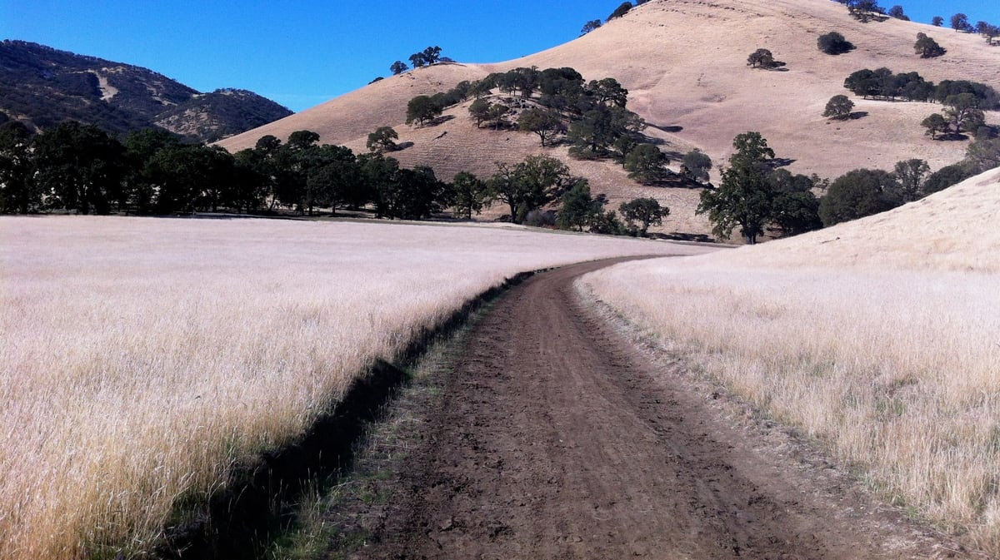
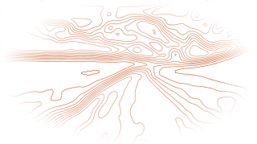

I've used the Benjamin Moore color Barren Plain in most rooms in my house. Something about it is soothing, it goes with so many things, and frankly it looks good in every light. It's got way more character than plain white. That was my first impulse for the site. It's the header, footer, and photo background. Benjamin Moore suggested other colors that pair well with it. I wanted a lighter main background, so I went with Chantilly Lace. Eagle Rock, darkened, became the text color. Claude sampled the brick accent color from my citrus and hibiscus photos. I didn't ask.

The photos were my other impulse: a collage of shots that make me happy and show something about how I see the world. I compiled a folder of photos I wanted to share, and Claude labeled and ordered them, then used the Photos page as the first draft of the actual site. We honed it: Claude removed location data from the photos, and I suggested we make sure the photo themes are not juxtaposed in the collage. I went with Claude's first draft of the page headline but edited the copy. Pollinator had to be in there.

The rest of the site content came from my writing samples from Moderne and my profile on LinkedIn. Claude added lines and eyebrows. I requested their removal. Claude decided to include a print-ready résumé (brilliant!). The home page first draft was plain, so I suggested we take one of the photos and make it more abstract to use as a background in the hero. Claude tried outlining a number of the photos, and we landed on the road with hills photo, outlined in brick.

 

We brainstormed title and copy, focusing on purpose-built stories, which is the heart of what I do.

I did some copy editing as we went along, honing headlines and text. Confession: I'm an iterator. I added the alliterative "books, briefs, and blogs." Claude suggested "light"; I chose "focus," which keeps the connection to both writing and photos. That's the beauty of partnering with AI. I can continue to improve and hone as time and tokens permit. I can add or remove pictures, and Claude can do the updates in seconds.

The initial pass was all done in a local project folder, with Claude handling the coding:

- Building the site with Astro, a tool that turns content files into a fast, plain website.
- Writing an import script that copies the content into the site. It resizes the photos and strips their GPS data, so originals never go online.
- Adding the extras: a link preview card, a sitemap, search-engine and AI-readable profile information, and a print or save-as-PDF option for the résumé.

Then Claude moved the site to my GitHub account, creating a public repository there and taking care of business:

- Ensuring commits use GitHub's private "noreply" address, so my email never appears.
- Adding an automatic publish step (a GitHub Actions workflow). Every time a change is pushed, GitHub builds the site and publishes it to GitHub Pages, its free hosting.
- Turning on Pages and connecting it to the new domain I purchased: patriciajohnson.me.
- Waiting for GitHub to issue the security certificate and making HTTPS required.
- Confirming that the site, the www and http versions, the sitemap, and the preview card all load correctly.

My part of the plumbing: buying the domain and pointing it to GitHub.

Not counting my prep time to collate the content for the site, but including the tool setup and connectivity needed, my live time working with Claude to produce the site was about seven hours.

I've worked with coding agents from Claude and OpenAI for more than a year, and I've built web pages with Claude before. What was different this time was the whole arc: from a paint color on my walls to a live site with its own domain, in less than a working day. I'm not a programmer, but Claude has enabled me to be a builder. It brings good ideas to the table and covers the back end, which is a skill unto itself.

And here's what Claude had to say:

> A calm, personal portfolio that pairs real expertise with a real eye, and it's built well underneath. I wrote the code and drafted options; Pat made the calls that give it its character.
